# ReflexBoard: a reaction-time trainer on the DE10-Standard

In this tutorial we build **ReflexBoard**, a small sports-training game that runs on the
**HPS (ARM Cortex-A9) of the DE10-Standard under Embedded Linux**. The board lights its
USER LED at a random moment and you hit the USER BUTTON as fast as you can. The board measures
your reaction time to a fraction of a millisecond and shows the result on its **128×64 LCD**.

Reaction time matters in almost every sport: a goalkeeper diving for a penalty, a sprinter
leaving the blocks, a tennis player returning a serve. Elite athletes react in about 150–200 ms.
How fast are you?

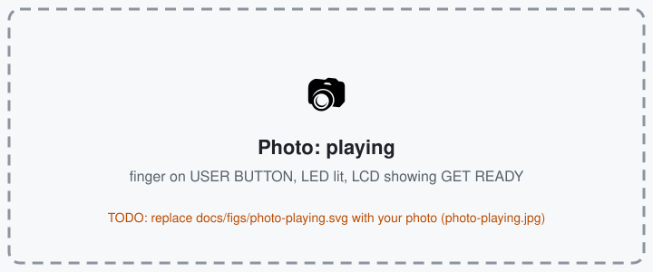

| Title | Get ready | Result | False start | Final results |
|:---:|:---:|:---:|:---:|:---:|
| 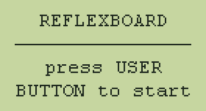 | 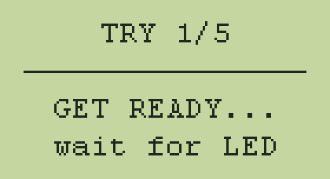 | 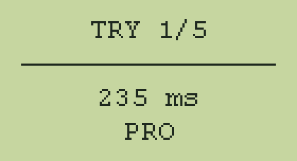 | 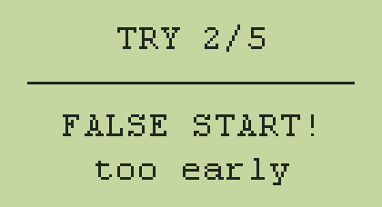 | 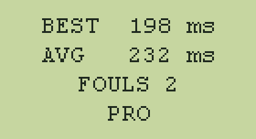 |

Along the way you will:

- cross-compile a C program on your PC for the ARM processor of the board;
- access hardware **from Linux user space** with `/dev/mem` and `mmap()` (GPIO and SPI);
- drive a graphic LCD over SPI;
- measure time precisely in Linux (`clock_gettime`) and learn what can spoil a measurement;
- deploy, run and debug the program on the board over the network (`scp`, `ssh`, `gdbserver`);
- test everything on your PC first with a **simulator**, before touching the hardware.

> [!NOTE]
> **Course learning objectives covered**
> - *Interface different modules in an embedded system (processors, firmware, and operating system)*:
>   a Linux program talks to the GPIO and SPI peripherals of the HPS and to an external LCD.
> - *Integrate a prototype solution for an embedded system with real-time requirements via FPGA-SoC*:
>   the game must time a human reaction with sub-millisecond precision on a general-purpose OS.

---

## The game

One round has **5 tries**. In each try:

1. The LCD shows `GET READY...`.
2. After a **random wait of 1 to 4 seconds**, the USER LED lights up.
3. You press the USER BUTTON as fast as you can. The LCD shows your time and a rating.

Two things count as a **foul**:

| Foul | When | LCD |
|---|---|---|
| **FALSE START** | you press *before* the LED lights up (guessing doesn't work!) |  |
| **TOO SLOW** | you don't press within 2 seconds | 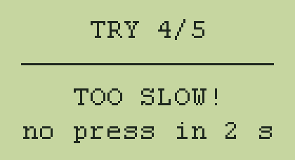 |

After 5 tries the board shows your **best** time, your **average**, the number of fouls and a rating:

| Average | Rating |
|---|---|
| < 200 ms | WORLD CLASS |
| 200–249 ms | PRO |
| 250–299 ms | GOOD |
| 300–399 ms | AVERAGE |
| ≥ 400 ms | KEEP TRAINING |

Press the button again to play another round. `Ctrl+C` quits.

---

## Getting started

To follow this tutorial you will need:

- **Hardware**
    - DE10-Standard kit with its power supply
    - microSD card (8 GB or more)
    - **Ethernet cable** (board ↔ PC)
    - **USB-A ↔ mini-USB cable** for the serial console (*not* the USB-Blaster cable)
- **Software**
    - Linux PC, or Windows 11 with **WSL** (Ubuntu). This tutorial was written on Windows 11 + WSL.
    - Linaro GCC 7.4.1 (`arm-linux-gnueabihf`) and Intel SoCEDS 18.1 (installed in Part 1)
    - Terasic **Linux Console (Kernel 4.5)** image for the SD card (Part 2)

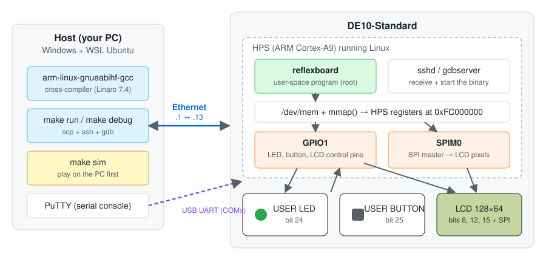

The diagram shows the whole system: the program is compiled on the **host** (your PC), sent to the
**target** (the board) over Ethernet and executed by Linux on the HPS. To reach the LED, the button
and the LCD it maps the HPS registers into its memory with `mmap()`. The serial console is used to
set the board up and to watch it boot.

---

## Part 1: Prepare the host (your PC)

### 1.1 WSL (only if you use Windows)

The ARM toolchain only runs on Linux. On Windows we use **WSL** (Windows Subsystem for Linux).

> [!TIP]
> **Task**
>
> 1. Open **PowerShell as Administrator** and run `wsl --install`, then **restart** the PC.
> 1. Install Ubuntu: `wsl --install -d Ubuntu`. Create your Linux user and password.
> 1. Make WSL share the PC's network interfaces, so it can reach the board. Create the file
>    `C:\Users\<you>\.wslconfig` with:
>    ```ini
>    [wsl2]
>    networkingMode=mirrored
>    ```
>    and run `wsl --shutdown` in PowerShell.
> 1. Install the Windows tools you will use for the board: `winget install --id Balena.Etcher -e` and
>    `winget install --id PuTTY.PuTTY -e`.

> [!NOTE]
> If `wsl` says *virtualization is not enabled*, turn on virtualization (SVM / VT-x) in your PC's BIOS.

From now on, every command that starts with `$` is typed in the **Ubuntu** terminal.

### 1.2 Get the code

```bash
$ cd ~
$ git clone https://github.com/Erivela21/reflexboard.git
$ cd reflexboard
```

The repository contains:

| Path | What it is |
|---|---|
| `src/main.c` | the game: tries, timing, fouls, results |
| `src/board.c` | real hardware: LED, button and LCD through `/dev/mem` |
| `src/board_sim.c` | PC simulator: keyboard = button, LCD frames saved as images |
| `src/screen.c` | 4 lines of text on the LCD |
| `lib/terasic_lcd/` | Terasic's LCD driver and graphics library (from the DE10-Standard System CD) |
| `Makefile` | `make`, `make sim`, `make run`, `make debug`, ... |
| `tools/setup-host.sh` | installs the toolchain (next step) |

### 1.3 Toolchain: Linaro GCC + SoCEDS

We need the same tools as the course tutorial *Tutorial-HPS-BuildSystem*:

- **Linaro GCC 7.4.1** `arm-linux-gnueabihf`: the cross-compiler that generates ARM code on your x86 PC;
- **Intel SoCEDS 18.1**: we only need its **hwlib** headers, which describe every HPS register
  (`ALT_GPIO1_SWPORTA_DR_ADDR`, `ALT_SPIM0_DR_ADDR`, ...).

The script `tools/setup-host.sh` installs both and adds the variables `GCC_Linaro`,
`SOCEDS_DEST_ROOT`, ... to your `~/.bashrc`.

> [!WARNING]
> Two download links from the original course tutorial no longer work:
> - `releases.linaro.org` now redirects to a contact page. The script downloads the **same** Linaro
>   file from TechNexion's mirror instead.
> - The SoCEDS installer (2.6 GB) is now on Altera's site and **requires a (free) login**, so it can't
>   be downloaded by a script. Download it with your browser first.

> [!TIP]
> **Task**
>
> 1. Sign in at
>    [altera.com (SoC EDS Standard 18.1 for Linux)](https://www.altera.com/downloads/embedded-tools/soc-fpga-embedded-development-suite-soc-eds-standard-edition-software-version-18-1-linux)
>    and download `SoCEDSSetup-18.1.0.625-linux.run` into your **Downloads** folder
>    (on Windows, the normal `C:\Users\<you>\Downloads` works: the script looks there).
> 1. Run the setup script and wait. The SoCEDS install takes a few minutes:
>    ```bash
>    $ bash tools/setup-host.sh
>    $ source ~/.bashrc
>    ```
> 1. Check:
>    ```bash
>    $ arm-linux-gnueabihf-gcc --version
>    arm-linux-gnueabihf-gcc (Linaro GCC 7.4-2019.02) 7.4.1 20181213
>    ```

### 1.4 Build it

> [!TIP]
> **Task**
>
> ```bash
> $ make
> ```

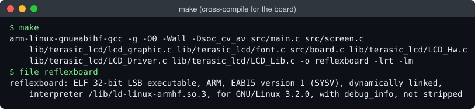

`file` confirms that `reflexboard` is an **ARM** executable: it can't run on your PC, only on the board.

> [!NOTE]
> The program only needs `GLIBC_2.4` from the board, so it runs on the old Linux of the Terasic
> image (glibc 2.20). You can check it yourself:
> `arm-linux-gnueabihf-objdump -T reflexboard | grep GLIBC_`

---

## Part 2: Prepare the board

### 2.1 SD card

> [!CAUTION]
> Writing an image erases the whole card. Make sure you select the SD card, not one of your disks.

> [!TIP]
> **Task**
>
> 1. Download **Linux Console (Kernel 4.5)** for the DE10-Standard from Terasic:
>    [DE10-Standard_Linux_Console.zip](https://download.terasic.com/downloads/cd-rom/de10-standard/Linux/DE10-Standard_Linux_Console.zip)
>    (510 MB) and extract `de10_standard_linux_console.img`.
> 1. Open **balenaEtcher** → *Flash from file* → the `.img` → *Select target* → your SD card → *Flash!*
> 1. After flashing, Windows shows *"You need to format the disk..."* one or more times.
>    Click **Cancel** every time (Windows can't read the Linux partition; formatting would destroy it).
> 1. Check: a small drive (~500 MB) now shows `zImage`, `socfpga.dtb` and `u-boot.scr`.
> 1. Eject the card and insert it in the microSD slot, next to the UART mini-USB port (see the photo in 2.2).

On Linux you can use `dd` instead, as in the course tutorial *Tutorial-HPS-Running*.

### 2.2 Cables

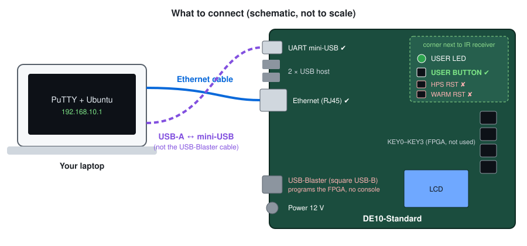

The board has **two** USB device ports, and it's easy to pick the wrong one:

- the **UART mini-USB**, next to the microSD slot and the two USB host ports: this is the serial console. ✔
- the **USB-Blaster** (square USB-B, next to the power jack): it programs the FPGA and won't give you a console. ✘

If Windows shows *Altera USB-Blaster II* instead of a *USB Serial Port*, you used the wrong one.

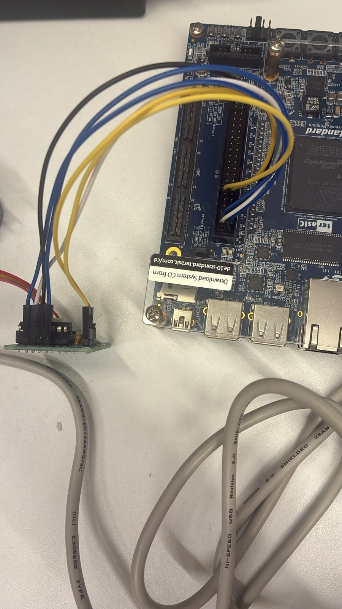

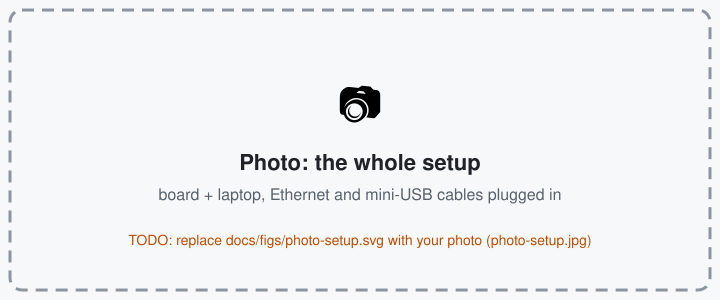

> [!TIP]
> **Task**
>
> 1. Ethernet cable: board ↔ your PC.
> 1. mini-USB cable: board **UART** port ↔ your PC.
> 1. Power supply, then press the red power button.

### 2.3 Serial console

> [!TIP]
> **Task**
>
> 1. Windows: **Device Manager → Ports (COM & LPT)** → note the number of **USB Serial Port (COMx)**.
>    If you only see *FT232R USB UART* with a warning icon, the FTDI driver is missing:
>    right-click → *Update driver → Search automatically*, or install it from
>    [ftdichip.com](https://ftdichip.com/drivers/vcp-drivers/).
> 1. Open **PuTTY**: *Connection type* **Serial**, *Serial line* `COMx`, *Speed* `115200`, **Open**.
>    (On Linux: `screen /dev/ttyUSB0 115200`.)
> 1. Press Enter and log in as `root` (no password).

You should see the Ångström login:

```
The Angstrom Distribution socfpga ttyS0

Angstrom v2014.12 - Kernel

socfpga login: root
root@socfpga:~#
```

### 2.4 Network

We connect the board straight to the PC with a fixed address on each side:

| | IP | Netmask |
|---|---|---|
| PC (host) | `192.168.10.1` | `255.255.255.0` |
| DE10-Standard (target) | `192.168.10.13` | `255.255.255.0` |

> [!WARNING]
> Don't use the `169.254.x.x` addresses of the course's *info-HPS-ethernet* page with WSL: those
> link-local addresses are not shared with WSL in mirrored mode, so Ubuntu can't reach the board.

> [!TIP]
> **Task: PC side** (Windows, **PowerShell as Administrator**)
>
> ```powershell
> netsh interface ip set address "Ethernet" static 192.168.10.1 255.255.255.0
> New-NetFirewallRule -DisplayName "DE10 ping" -Protocol ICMPv4 -IcmpType 8 -Action Allow
> ```
>
> `"Ethernet"` is the name of the adapter in *Settings → Network*. On a Linux PC use
> `sudo ip addr add 192.168.10.1/24 dev <interface>`.

The Terasic image doesn't give the Ethernet port a valid **MAC address** (`ifconfig` shows
`HWaddr 00:00:00:00:00:00`), so we set one before bringing the port up.

> [!TIP]
> **Task: board side** (PuTTY)
>
> ```sh
> ifconfig eth0 down
> ifconfig eth0 hw ether 02:01:02:03:04:08
> ifconfig eth0 192.168.10.13 netmask 255.255.255.0 up
> ping -c 3 192.168.10.1
> ```
>
> Wait for `eth0: Link is Up`. The ping should answer `3 packets received`.

This configuration is lost at every reboot. The repository has an init script that does it at boot;
we install it in the next step, once we can copy files.

### 2.5 SSH access

`make run` copies the program with `scp` and starts it with `ssh`. SSH refuses users with an empty
password, so first give `root` a password, then install your SSH key so `make` never asks for it.

> [!TIP]
> **Task**
>
> 1. On the board (PuTTY): `passwd` (for example `root`, typed twice).
> 1. On the PC (Ubuntu), in the `reflexboard` folder:
>    ```bash
>    $ ping -c 3 192.168.10.13
>    $ make ssh-key            # asks for the board's password one last time
>    $ make ssh                # opens a shell on the board, no password: type exit
>    ```
> 1. Make the network start at every boot:
>    ```bash
>    $ scp -O tools/S60MAC.sh root@192.168.10.13:/etc/init.d/
>    $ ssh root@192.168.10.13 "chmod +x /etc/init.d/S60MAC.sh && systemctl enable S60MAC.sh && sync"
>    ```
>    After the next reboot, the boot log shows `Started LSB: Bring up eth0 on the DE10-Standard`.

---

## Part 3: Try it on your PC first (simulator)

Testing on hardware is slow: compile, copy, run, press buttons... Most of the program (the game logic,
the timing, what the LCD shows) doesn't depend on the hardware at all. So the code separates the
hardware behind four functions (`src/board.h`):

```c
int  board_init(void);    /* map the registers, switch the LCD on */
void board_close(void);
void board_led(bool on);  /* USER LED */
bool board_button(void);  /* USER BUTTON, true while pressed */
```

`src/board.c` implements them for the real board. `src/board_sim.c` implements them on the PC:
**any key is the button**, the LED is printed in the terminal, and every LCD frame can be saved as an image.
The rest of the program, including the Terasic LCD graphics library, is the **same code**.

> [!TIP]
> **Task**
>
> ```bash
> $ make sim
> ```
>
> Press any key to start, wait for `>>> LED ON <<<` and press a key as fast as you can.
> Try pressing too early, and try not pressing at all.

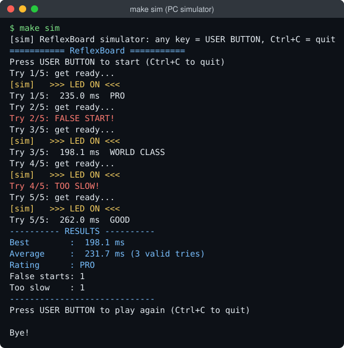

To see what the LCD would show, save the frames as images:

```bash
$ mkdir -p out && REFLEX_LCD_DUMP=out ./reflexboard-sim
$ python3 tools/lcd2png.py out/lcd-003.pbm lcd.png
```

> [!NOTE]
> All the LCD screens and terminal screenshots in this tutorial were generated this way, by
> `tools/make_docs_images.sh`, which plays a scripted game (`REFLEX_SIM_AUTO="S,235,S,198,T,262"`).
> Simulated reaction times are exact, which also makes the simulator a handy test of the timing code.

---

## Part 4: Play on the board

> [!TIP]
> **Task**
>
> ```bash
> $ make run
> ```
>
> `make run` cross-compiles (if needed), copies `reflexboard` to `/home/root` on the board with `scp`
> and starts it with `ssh -t`. Then play on the **board**: the program's output appears in your terminal.

A real round played on the board while writing this tutorial (your times will be different):

```
scp -O ... reflexboard root@192.168.10.13:/home/root/reflexboard
ssh ... root@192.168.10.13 -t "cd /home/root && ./reflexboard"
=========== ReflexBoard ===========
Press USER BUTTON to start (Ctrl+C to quit)
Try 1/5: get ready...
Try 1/5:  399.5 ms  AVERAGE
Try 2/5: get ready...
Try 2/5: FALSE START!
Try 3/5: get ready...
Try 3/5:  252.6 ms  GOOD
Try 4/5: get ready...
Try 4/5:  166.9 ms  WORLD CLASS
Try 5/5: get ready...
Try 5/5:  179.6 ms  WORLD CLASS
---------- RESULTS ----------
Best        :  166.9 ms
Average     :  249.6 ms (4 valid tries)
Rating      : PRO
False starts: 1
Too slow    : 0
-----------------------------
Press USER BUTTON to play again (Ctrl+C to quit)
```

The first try (399.5 ms) is typical: you get faster once you know what to expect.

The button is the small one labelled **USER BUTTON**, in the corner next to the IR receiver,
above the big `KEY0` button. Right below it are `HPS RST` and `WARM RST`: **don't** press those,
they reboot the board. The USER LED is next to the button.

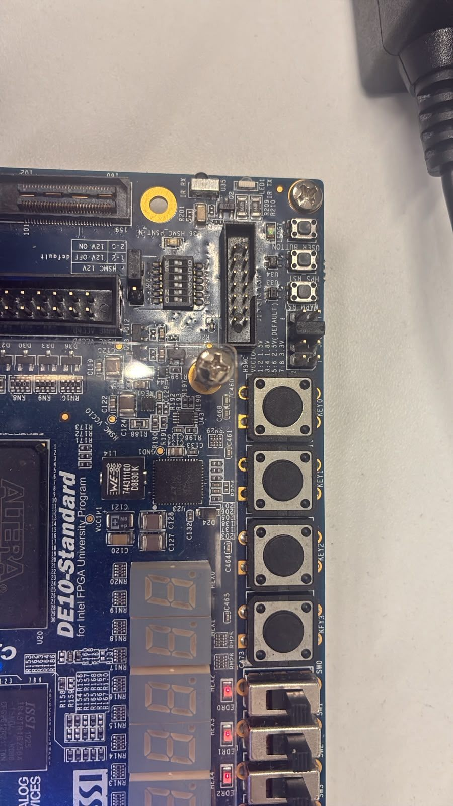

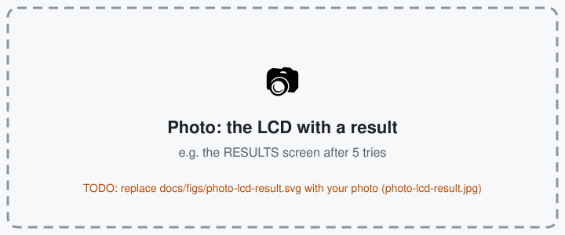

| Command | What it does |
|---|---|
| `make` | cross-compile `reflexboard` for the board |
| `make sim` | build and play the PC simulator |
| `make deploy` | copy the binary to the board |
| `make run` | deploy, then play on the board |
| `make debug` | deploy, start `gdbserver` on the board and attach `gdb` (Part 6) |
| `make ssh` | shell on the board |
| `make ssh-key` | install your SSH key on the board (once) |
| `make clean` | remove build files |

The board address can be changed on the command line: `make run TARGET_IP=192.168.0.42`.

---

## Part 5: How it works

### 5.1 Talking to the hardware from Linux

In a bare-metal program we could write directly to the address of a peripheral register.
In Linux, a program only sees **virtual** addresses: the MMU translates them, and the kernel doesn't
let a process touch physical memory. The device `/dev/mem` represents the physical memory, and
`mmap()` maps a part of it into our virtual address space (this needs `root`).

We map the 64 MB region where all the HPS peripherals live (`0xFC000000`, `ALT_STM_OFST` in hwlib),
exactly like the course's *Tutorial-HPS-BlinkLED* (`src/board.c`):

```c
fd = open("/dev/mem", O_RDWR | O_SYNC);
virtual_base = mmap(NULL, HW_REGS_SPAN, PROT_READ | PROT_WRITE, MAP_SHARED, fd, HW_REGS_BASE);
```

A register at physical address `addr` is now at `virtual_base + (addr & HW_REGS_MASK)`:

```c
#define REG(addr) ( virtual_base + ( ( uint32_t )( addr ) & ( uint32_t )( HW_REGS_MASK ) ) )

void board_led(bool on)
{
	if ( on )
		alt_setbits_word( REG( ALT_GPIO1_SWPORTA_DR_ADDR ), BIT_LED );
	else
		alt_clrbits_word( REG( ALT_GPIO1_SWPORTA_DR_ADDR ), BIT_LED );
}

bool board_button(void)
{
	uint32_t scan_input = alt_read_word( REG( ALT_GPIO1_EXT_PORTA_ADDR ) );
	return ( ~scan_input & BIT_BUTTON ) != 0;   /* active low */
}
```

The LED, the button **and the LCD control pins** are all bits of the same peripheral, **GPIO1**:

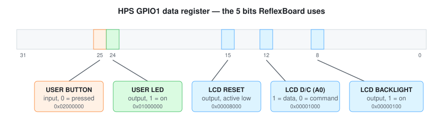

- `SWPORTA_DDR` (data direction): 1 = output. We set the LED bit; the button stays an input.
- `SWPORTA_DR` (data register): the value driven on the output pins.
- `EXT_PORTA`: the value read on the pins. The button pulls its pin to **0** when pressed.

> [!NOTE]
> Because every module shares GPIO1, it must only change **its own bits**. That's why the code uses
> `alt_setbits_word` / `alt_clrbits_word` (read-modify-write) instead of writing the whole register:
> turning the LED off must not switch the LCD backlight off.

### 5.2 The LCD

The 128×64 graphic LCD is driven through **SPI master 0 (SPIM0)** of the HPS plus three GPIO1 pins
(reset, data/command and backlight). We reuse Terasic's driver from the DE10-Standard System CD
(`lib/terasic_lcd`, originally `Demonstration/SoC/hps_lcd`):

- `LCD_Hw.c` configures SPIM0 and toggles the GPIO pins;
- `LCD_Driver.c` / `LCD_Lib.c` send the commands of the LCD controller;
- `lcd_graphic.c` draws pixels, lines and text in a **frame buffer in RAM** (1 KB, 1 bit per pixel);
- `DRAW_Refresh()` copies the whole frame buffer to the LCD over SPI.

`src/screen.c` uses it to show 4 centered lines of 16 characters (the font is 8×16 pixels):

```c
DRAW_Clear(&canvas, LCD_WHITE);
DRAW_PrintString(&canvas, x, row * 16, text, LCD_BLACK, &font_16x16);
DRAW_Refresh(&canvas);
```

### 5.3 Measuring a reaction time on Linux

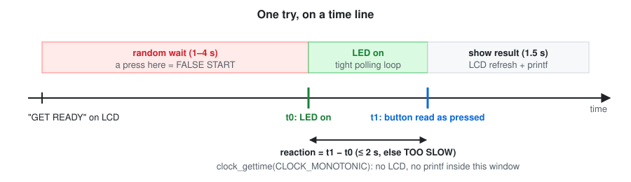

Linux is not a real-time OS: our process can be interrupted at any moment, and some operations are
slow. To keep the measurement honest (`src/main.c`):

1. **Use a monotonic clock.** `clock_gettime(CLOCK_MONOTONIC)` has nanosecond resolution and never
   jumps (the time of day can be changed by NTP while you play).
2. **Do the slow work before the LED lights.** Refreshing the LCD sends 1 KB over SPI, and `printf`
   goes through SSH. Both happen *before* `t0`, never between `t0` and the press.
3. **Poll tightly while timing.** Between the LED and the press, the loop only reads the button
   register: no `usleep`, because waking up from a sleep adds an unpredictable delay.

```c
board_led(true);
t0 = now_ms();
do {
	t1 = now_ms();
} while (!board_button() && t1 - t0 < TIMEOUT_MS && !quit);
board_led(false);
```

The loop takes 100% of one CPU core for at most 2 seconds. The HPS has two cores, so Linux stays
responsive. Each pass of the loop takes a few microseconds, so the press is seen almost immediately.
The remaining error comes from the Linux scheduler: if it interrupts our process just as you press,
the press is seen a little later. On an idle board this is rare and small compared to the differences
between human reactions (tens of milliseconds); the *Going further* section suggests how to measure it.

> [!NOTE]
> **False starts.** The random wait (1–4 s, `rand()`) stops you from guessing when the LED will
> light. During the wait the program checks the button every millisecond: any press is a false start.

### 5.4 The game flow

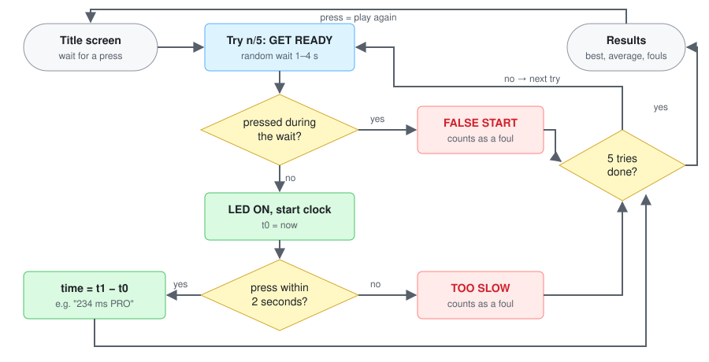

### 5.5 Exiting cleanly

The program registers a handler for `SIGINT` (Ctrl+C), `SIGTERM` and `SIGHUP` (the SSH connection
closes). The handler only sets a flag; every loop checks it, and `main` then clears the LCD, turns
off the LED and the backlight, and unmaps the registers. Without this, quitting in the middle of a
try could leave the LED on.

---

## Part 6: Debug on the board

The program is compiled with `-g -O0`, so `gdb` can show every variable. `make debug` copies the
binary, starts **gdbserver** on the board (the Terasic image already has it) and connects
`gdb-multiarch` from your PC over the network.

> [!TIP]
> **Task**
>
> ```bash
> $ make debug
> (gdb) break play_try        # stop at the start of every try
> (gdb) continue              # press USER BUTTON on the board to start
> (gdb) next                  # step through the try...
> (gdb) break 121             # board_led(false): right after the timing loop
> (gdb) continue              # wait for the LED and press the button
> (gdb) print t1 - t0         # your reaction time in ms
> (gdb) info locals
> (gdb) continue
> ```

> [!WARNING]
> While gdb has the program stopped, the clock keeps running. A try you pause in the middle
> will be measured as very slow or as a false start: that's expected.

---

## Troubleshooting

| Problem | Fix |
|---|---|
| No *USB Serial Port* in Device Manager | Wrong port (USB-Blaster) or missing FTDI driver; see 2.3 |
| PuTTY window stays empty | Press Enter; check COM number and speed 115200; press `WARM_RST` to see the boot |
| `ping 192.168.10.13` fails | On the board run `ifconfig eth0`: the MAC must not be `00:00:00:00:00:00` and the IP must be set (2.4) |
| `make: arm-linux-gnueabihf-gcc: Command not found` | Run `source ~/.bashrc`, or redo 1.3 |
| `hwlib.h: No such file or directory` | `SOCEDS_DEST_ROOT` is not set: `source ~/.bashrc` |
| `make run` asks for a password every time | Run `make ssh-key` once |
| `ERROR: could not open "/dev/mem"` | The program must run as `root` |
| LCD stays blank | Check the backlight is on; run Terasic's original `hps_lcd` demo to rule out the hardware |
| Every try is a FALSE START | You may be holding the button; check that `EXT_PORTA` bit 25 reads 1 when released |

---

## Going further

- **Use Linux drivers instead of `/dev/mem`**: the button and LED through `/sys/class/gpio` (with
  `poll()` to wait for the button *interrupt* instead of polling), and the LCD through `spidev`.
  Terasic's `LCD_Hw.c` already has a `USE_SPI_DRIVER` option. Compare the measured reaction times.
- **Latency study**: measure how much the timing jitters while the board is busy
  (for example `stress` in another SSH session), with and without `chrt -f 99 ./reflexboard`.
- **Start at boot**: a systemd service that starts `reflexboard`, so the board becomes a standalone device.
- **Leaderboard**: save the best times in a file, or serve them on a small web page.
- **FPGA**: show the time on the 7-segment displays through the lightweight HPS-to-FPGA bridge.

---

## Credits

- LCD driver and graphics library: Terasic, DE10-Standard System CD (`Demonstration/SoC/hps_lcd`),
  used on the Terasic board as allowed by its license.
- Course *Embarcados Avançados* (Insper): tutorials *Tutorial-HPS-Running*, *Tutorial-HPS-BuildSystem*,
  *Tutorial-HPS-BlinkLED* and *info-HPS-ethernet*, on which this tutorial builds.
